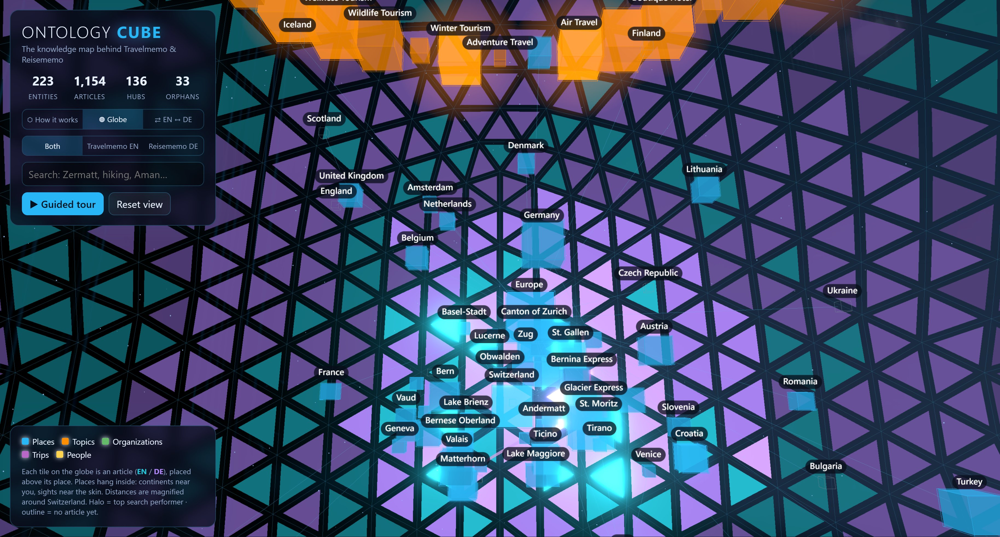
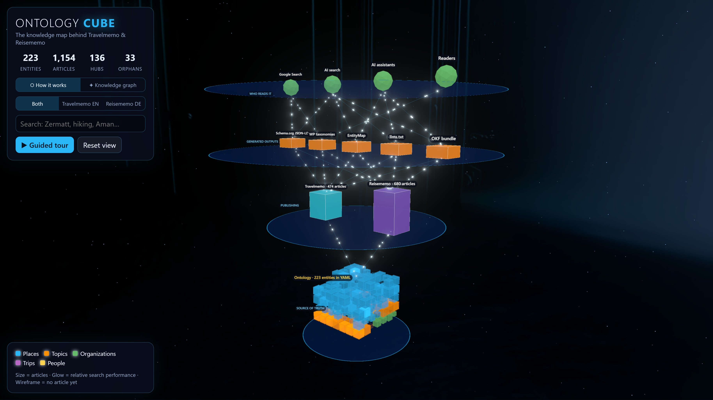
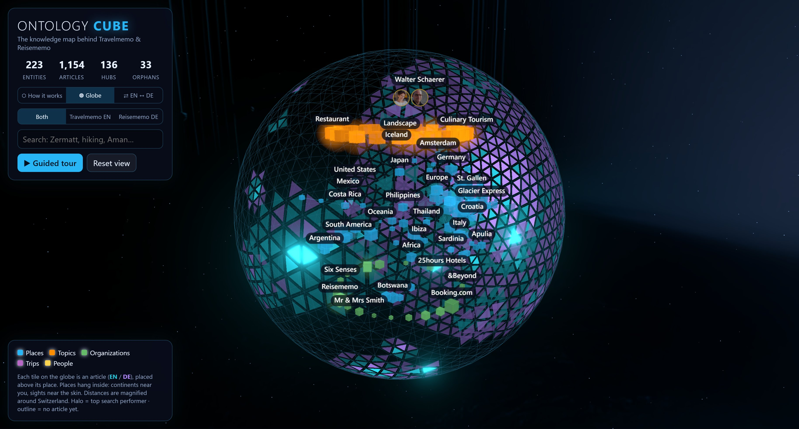
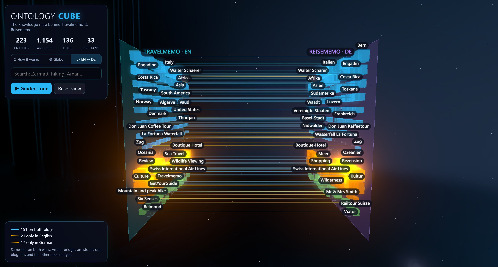

# Ontology Memo

Interactive 3D map of the knowledge graph behind
[travelmemo.com](https://travelmemo.com) and [reisememo.ch](https://reisememo.ch).
Every box is one entity from the ontology both blogs share: a place, a topic,
an organization, a trip or an author.

**Live:** https://webmemo-code.github.io/travel-ontology-visualization/

## Three views

**⬡ How it works.** The entities pack into a literal cube: the ontology, the
single source of truth. Stacked above it are the two WordPress sites, the five
generated outputs (JSON-LD, taxonomies, EntityMap, llms.txt, OKF) and the
groups that read them. Click any tile for a plain-language explanation.

**◍ Globe.** The cube unfolds into a wireframe globe. It opens from outside,
with Switzerland facing you; fly inside to see the places hanging on their shells.

| Encoding | Meaning |
|---|---|
| Tile on the skin | One article (turquoise EN, violet DE); brightness = relative search tier |
| Country patch | A country's articles as one patch of tiles, **sized by article count, not area**; gold lines trace true borders |
| Gold lines | True country borders (Natural Earth) on the same globe, so you can see how far the article-sized patches stretch Switzerland |
| Boxes inside | Places on shells by level: continents nearest you, sights nearest the skin |
| Directions | Patches grow around each country's real direction from Switzerland; neighbours settle on Switzerland's rim |
| Sky / floor | Topics form the ceiling, organizations the floor, the authors' faces the zenith |
| Purple tubes | Trips, drawn stop by stop in itinerary order |
| Halo / outline | Top 10% or top 25% search performer / orphan with no article yet |
| Select | An entity lights its articles in gold (dim amber where filed under another country), with rays out to each; an article draws rays to its entities |

**⇄ EN ↔ DE.** Travelmemo and Reisememo as facing walls, with each entity in
the same slot on both. Cyan bridges mark subjects both blogs cover. Amber
bridges fade toward the blog that has not written about the subject yet: the
translation and content backlog.

**● Live** (globe view, or `?live` in the URL): Readers of the last 30 minutes glow at their country, with a
flowing arc to the article they read (GA4 Realtime). AI agents are
satellites coloured by purpose (training, search, on a user's behalf): each
hovers over its operator's headquarters, drops a thin line to the country its
request came from (Cloudflare on Travelmemo, IPinfo Lite on Reisememo), and beams to the article or entity it fetched. 

Bots whose operator is not known for certain keep orbiting. Agents on article pages are not
seen, because the page cache serves those without PHP. `?live=demo` feeds
made-up traffic for previews and recordings.

## Lifted from the Periodic Cube of AI

Inspired by Walter's [Periodic Cube of AI](https://webmemo.ch/periodic-cube-of-ai)
